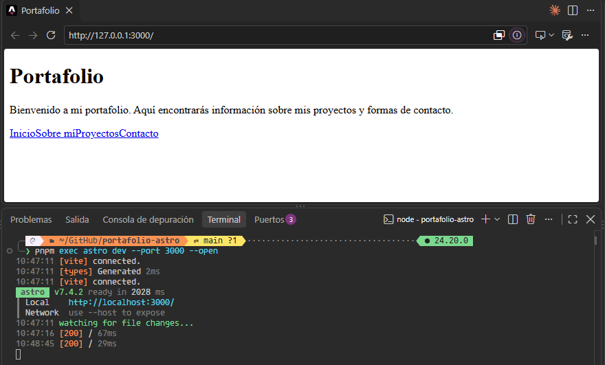
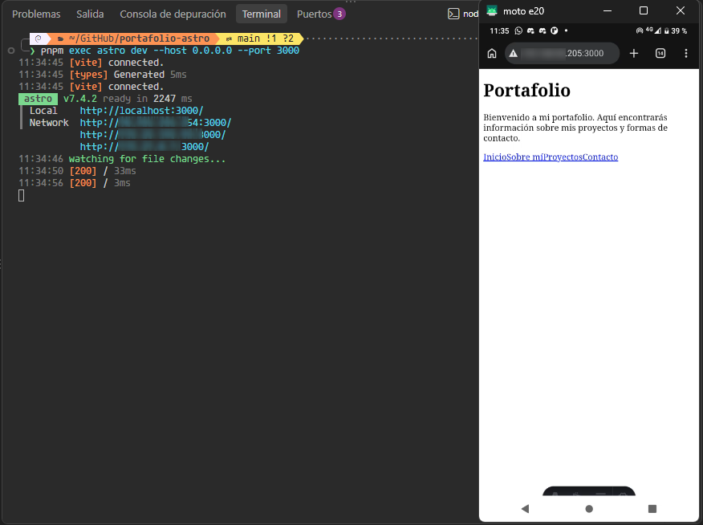
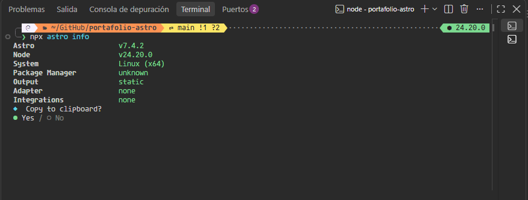
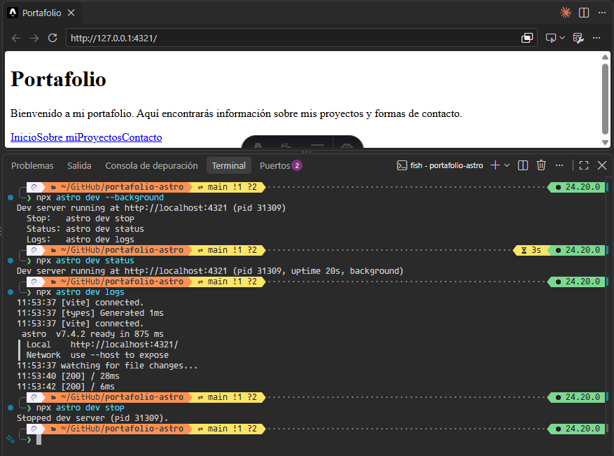
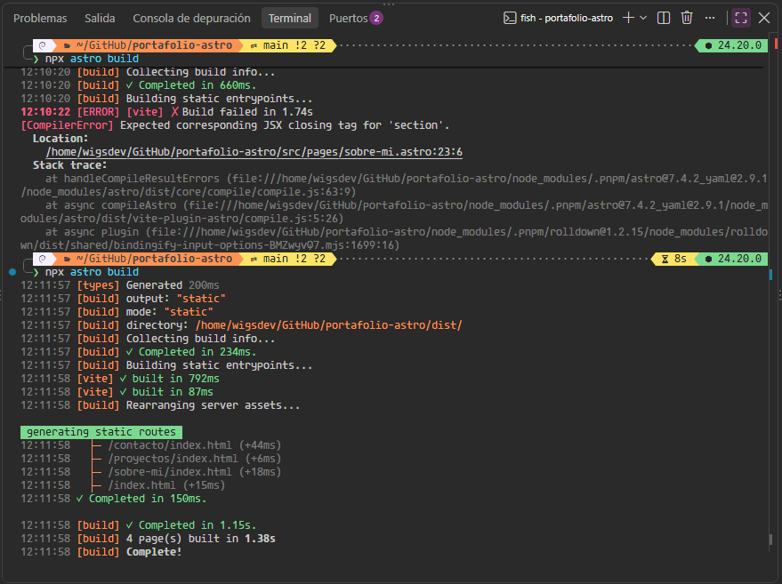

# Portafolio personal

Repositorio: [github.com/wigsdev/portafolio-astro](https://github.com/wigsdev/portafolio-astro)

```sh
pnpm create astro@latest -- --template minimal
```
## 🚀 Estructura del proyecto

Dentro del proyecto Astro encontrarás las siguientes carpetas y archivos:

```text
/
├── public/
│   ├── blog.jpg
│   ├── cv.pdf
│   ├── favicon.ico
│   ├── favicon.svg
│   ├── markdown-to-pdf.png
│   └── pomodoro.jpg
├── src/
│   └── pages/
│       ├── contacto.astro
│       ├── index.astro
│       ├── proyectos.astro
│       └── sobre-mi.astro
├── astro.config.mjs
├── package.json
├── pnpm-lock.yaml
├── README.md
└── tsconfig.json
```

Astro busca archivos `.astro` o `.md` en el directorio `src/pages/`. Cada página se publica en una ruta que se determina a partir del nombre del archivo.

Puedes colocar recursos estáticos, como imágenes, en el directorio `public/`.

## 🧞 Comandos

Ejecuta todos los comandos desde una terminal abierta en la raíz del proyecto:

| Comando                   | Acción                                           |
| :------------------------ | :----------------------------------------------- |
| `pnpm install`             | Instala las dependencias del proyecto.           |
| `pnpm run dev`             | Inicia el servidor de desarrollo en `localhost:4321`. |
| `pnpm run build`           | Compila el sitio para producción en `./dist/`.   |
| `pnpm run preview`         | Muestra localmente la compilación antes de publicarla. |

## Guía del CLI

Los comandos de esta guía se ejecutan desde la raíz del proyecto. Cada apartado explica su propósito y resume el resultado de la prueba.

### 1. Servidor en el puerto 3000

```bash
pnpm exec astro dev --port 3000 --open
```

Este comando inicia Astro en el puerto `3000` y abre el sitio en el navegador.

- **Resultado:** Astro v7.4.2 inició correctamente en `http://127.0.0.1:3000/`. El navegador abrió el sitio y la terminal registró respuestas `200`.
- **Captura:** 

### 2. Acceso desde un celular en la misma red Wi-Fi

```bash
pnpm exec astro dev --host 0.0.0.0 --port 3000
```

La opción `--host 0.0.0.0` permite conexiones desde otros dispositivos de la red. Con el celular conectado a la misma Wi-Fi, se abre la IP local de la laptop seguida de `:3000`.

- **Resultado:** El sitio abrió correctamente en el celular. Como Astro se ejecutaba en WSL, se configuró el reenvío del puerto 3000 y una regla de firewall limitada a la subred local.
- **Dirección:** IP local de la laptop seguida de `:3000`. No se incluye porque es privada y puede cambiar.
- **Captura:** 

### 3. Información del entorno Astro

```bash
npx astro info
```

- **Resultado:**

  ```text
  Astro                    v7.4.2
  Node                     v24.20.0
  System                   Linux (x64)
  Package Manager          unknown
  Output                   static
  Adapter                  none
  Integrations             none
  ```

- **Qué significa cada línea:**
  - `Astro`: versión del framework del proyecto.
  - `Node`: versión de Node.js en uso.
  - `System`: sistema operativo y arquitectura detectados.
  - `Package Manager`: aparece como `unknown` en esta salida.
  - `Output`: `static` indica que el sitio se genera como archivos estáticos.
  - `Adapter`: `none` indica que no se configuró un adaptador de servidor.
  - `Integrations`: `none` indica que no hay integraciones instaladas.
- **Captura:** 

### 4. Servidor en segundo plano

```bash
npx astro dev --background
npx astro dev status
npx astro dev logs
npx astro dev stop
```

`--background` inicia Astro en segundo plano. `status` comprueba si sigue activo, `logs` muestra la salida y `stop` lo detiene. En esta prueba, Astro v7.4.2 respondió en `localhost:4321` y la terminal registró respuestas `200`; después, el servidor se detuvo correctamente.

- **Captura:** 

### 5. Error de compilación y corrección

Para provocar el error, se dejó abierta una etiqueta HTML y se ejecutó:

```bash
npx astro build
```

- **Mensaje de error obtenido:** `[CompilerError] Expected corresponding JSX closing tag for 'section'.` Astro indicó que el error estaba en `src/pages/sobre-mi.astro:23:6`.
- **Corrección aplicada:** Se añadió el cierre correspondiente, `</section>`.
- **Resultado del build corregido:** `npx astro build` terminó correctamente y generó las cuatro páginas estáticas.
- **Captura:** 
